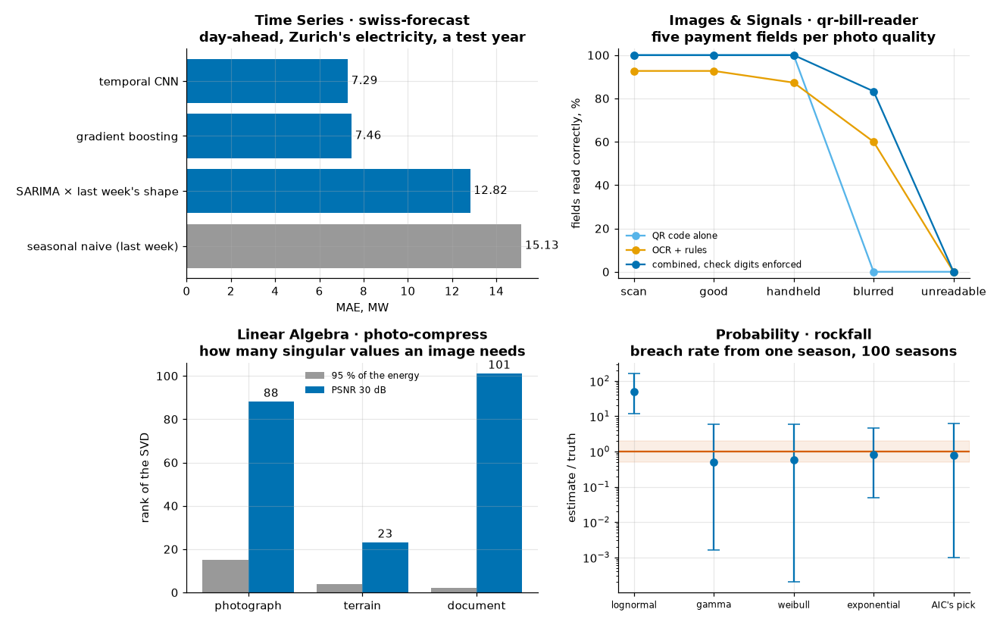
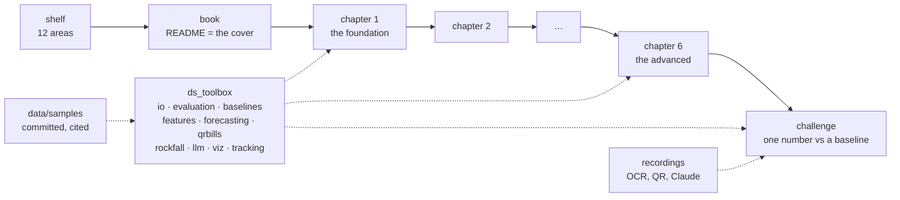

# data-science-bookshelf

[](https://github.com/riccardito/data-science-bookshelf/actions/workflows/ci.yml)

[](LICENSE)

**Data science as a bookshelf: twelve shelves, 48 books, chapters as notebooks that build on each other, and a measured challenge closing every book.**



## What this is, and what you can do with it

To see the whole of data science, you look at the shelf. To understand a part of it, you take a book down and read it — and then the book is what matters, not the shelf. That is how I learned the field, and it is how this repository is built.

- **Read a book:** each book is a folder of Jupyter notebooks, chapter 1 the foundation and the last chapter the most advanced. They render on GitHub with their outputs.
- **Check a number:** every book ends in a challenge that measures one thing against a baseline. `make demo` re-runs all four challenges offline and prints their results.
- **Use the toolbox:** `ds_toolbox` holds what the chapters share — public Swiss data with a disk cache, honest evaluation, baselines, a recorder for model answers. It is tested at 98 %.
- **See what is missing:** [`CATALOGUE.md`](CATALOGUE.md) lists all 48 books with their chapters and challenges, written or not.

## The problem

Course notes show that someone attended. They rarely show that someone can measure. A notebook that ends in a nice plot says nothing about whether the method beat the obvious guess. And a body of knowledge spread across folders of old assignments cannot be read in order.

## The result

Four books are written. Each closes on a number, measured against a baseline on data nobody tuned on:

| Book | Challenge | The number |
|---|---|---|
| 21 · Time Series | **swiss-forecast** — Zurich's hourly electricity, a day ahead, over a year no model saw | **7.29 MW** mean absolute error (temporal CNN) against 15.13 MW for *the same day last week* |
| 27 · Images & Signals | **qr-bill-reader** — five payment fields from photos of invented Swiss QR bills | **83 %** of fields from a blurred photo, where the QR code alone reads 0 %; every tampered bill caught where the code decodes |
| 1 · Linear Algebra | **photo-compress** — how many singular values an image needs | **rank 23, 88 and 101** for 30 dB on a terrain, a photo and a document; the document holds 95 % of its energy at rank 2 |
| 3 · Probability | **rockfall** — a net's breach rate estimated from one season of 90 rocks, on a slope whose truth is known | the *true* distribution family lands within a factor of two only **33 %** of the time; the lognormal reads 50 times high |

Two of the four results are about a method's limits. That is on purpose. A forecast that halves the baseline's error is worth knowing. So is the fact that a rare-event estimate from one season can be wrong by two orders of magnitude while the fit to the data looks fine.

## The shelf

| Shelf | Books | Built |
|---|---:|---|
| I · Foundations | 5 | 1 Linear Algebra, 3 Probability |
| II · Programming & Algorithms | 5 | — |
| III · Data Engineering | 5 | — |
| IV · Exploratory Data Analysis | 3 | — |
| V · Statistical Learning & Regression | 3 | 21 Time Series |
| VI · Machine Learning | 4 | — |
| VII · Deep Learning | 3 | 27 Images & Signals |
| VIII · Specialized Domains | 5 | — |
| IX · Visualization & Communication | 3 | — |
| X · Ethics, Law & Society | 3 | — |
| XI · Applied Data Science | 5 | — |
| XII · Cross-Cutting Skills | 4 | — |

Four books are built. That is 24 chapters and four challenges. Five more have a written cover — what the topic covers, its tools, its limits — and 39 are planned, with their chapter outline in the catalogue. Seven books take their challenge from a sibling repository: [`fedlex-rag`](https://github.com/riccardito/fedlex-rag) for NLP and advanced deep learning, [`tardoc-validator`](https://github.com/riccardito/tardoc-validator) for data wrangling and the data-science process, [`agora-method`](https://github.com/riccardito/agora-method) for software engineering, knowledge management and AI-assisted programming. An empty book is more honest than a padded one.

## Quickstart

```bash
git clone https://github.com/riccardito/data-science-bookshelf && cd data-science-bookshelf
python -m venv .venv && . .venv/bin/activate   # Windows: .venv\Scripts\activate
make install install-dl && make demo
```

```
swiss-forecast  day-ahead MAE 7.29 MW (temporal CNN) against 15.13 MW for seasonal naive (last week)   [47 s]
qr-bill-reader  fields read: 100% on a handheld photo, 83% on a blurred one (QR alone 0%)   [8 s]
photo-compress  rank for 30 dB: photograph 88, terrain 23, document 101   [3 s]
rockfall        true 0.0165 breaches/yr; one season, true family within 2x 33% of the time, lognormal median 50x   [51 s]
```

Python 3.11; `install-dl` adds the CPU build of PyTorch. No key, no network: the data is committed as small samples and the model answers are recorded. `make check` runs what CI runs: ruff, the tests, every notebook re-executed, and the scans.

## How it is built



**A chapter is one idea in about fifteen minutes.** It opens with what it builds on and closes with exercises and a link to the next one. Where it teaches a method, it writes the 30-line version first — Gaussian elimination, Gram-Schmidt, a convolution, power iteration, a check-digit repair — and then shows that the library agrees.

**Shared code lives in `ds_toolbox`, never in two notebooks.** When a helper was needed twice, it moved into the package and got a test, and that is how the toolbox grew: the time-series features and the day-ahead CNN came from book 21, the QR-bill generator and the recorder from book 27, the rockfall model from book 3.

**Anything slow or machine-dependent is recorded.** OCR output can differ between Windows and Linux. A Claude answer costs money. Both go through one recorder that keys each request by the SHA-256 of its content and replays it. The 135 Claude calls behind `qr-bill-reader` were recorded once, for about $1.70.

**CI re-executes every chapter.** Lint covers the notebooks too, and two scans run on every push: one for secrets, one for private names, matched by hash so the names never appear in the repository.

## The data

Real where it can be, invented where it must be, and said which is which. The electricity series is the City of Zurich's open data (ewz, `terms_open`), the weekly national figure the Federal Office of Energy's (`terms_by`). The photo and the terrain model ship with matplotlib; the handwritten digits ship with scikit-learn. **The QR bills are invented:** valid QR-IBANs and references, no real account or person. **The rockfall slope is seeded:** fitted to the 68 rocks a 2019 course report printed, with the rest chosen and documented. Each file is listed with its source and licence in [`data/samples/README.md`](data/samples/README.md).

## What I learned, and what is open

**Most corrections came from the numbers, not from review.** I wrote every chapter's prose, executed it, and then compared each sentence with the output. Six claims in the time-series book changed that way — "twice the error" was 1.5 times; "a third more in January" was 12 %.

**The tests caught two defects a reader would never have seen.** The day-ahead CNN first started from random offsets. It was meant to correct a baseline, and it began somewhere else entirely. And my check-digit repair returned a *valid but wrong* IBAN in 2.4 % of simulated misreads, because its confusion table was one-way. Both are fixed and pinned.

**Simple won twice.** One hand-made sharpness feature classified photo quality as well as a CNN (100 % against 99 %), and a one-parameter exponential estimated a rare-event rate better than the true two-parameter family. Both chapters say so rather than hide it.

**A language model guesses where it was told not to.** On unreadable photos Claude filled in an amount eight times. A check digit catches a guessed IBAN; nothing catches a guessed amount. The reader should say "unreadable" instead, and the quality check from book 27's chapter 5 makes that possible.

Open:

- 44 books, the next being those whose challenge already exists in a sibling repository.
- An index of the shelf as a page, not only a catalogue file.
- Transfer learning, which needs a downloaded model and so breaks the offline rule; book 27 says why it was left out.

## Author

Built by Riccard Nef, AI engineer in Swiss healthcare IT — [LinkedIn](https://www.linkedin.com/in/riccard-nef-62683511b/) · [*The Agora Method*](https://medium.com/@stillwaiting/the-agora-method-b62263bde400).

## Licence

MIT for the code — see [LICENSE](LICENSE). Each dataset keeps its own terms, listed in [`data/samples/README.md`](data/samples/README.md).
